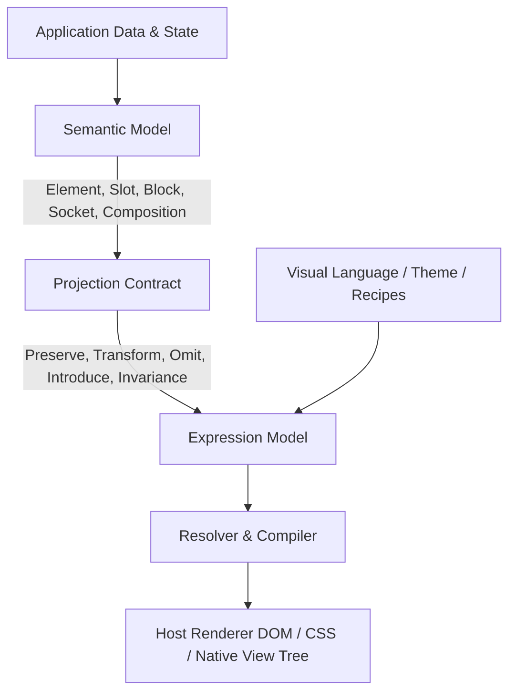

# Semantic Expression System

**SES** is the short name for this project.

[](./LICENSE)
[](./PROJECT_PROFILE.json)
[](./docs/SES-SPECIFICATION.md)

> **Version:** 1.0.0 Release Standard  
> **Status:** Protocol-Neutral Architecture Specification + Qualified Implementation Candidate  
> **Target:** 2D Interface Architecture for Radical Visual Expression  

---

**SES (Semantic Expression System)** is a protocol-neutral architecture for separating interface **meaning** from interface **expression**.

Its intent is to let a single stable semantic interface definition produce radically different rendered interfaces without duplicating application logic or fragmenting component behavior.

---

## 🎯 The Core Problem

Traditional UI architectures tightly couple interface semantics with layout and visual structure. As a result, changing presentation topology often forces developers to rewrite component templates, duplicate business logic, or break behavioral contracts.

**SES addresses a fundamental design challenge:**

> *How can an interface preserve what it means and what it does, while allowing nearly everything about how it looks and arranges itself to change?*

---

## 🏗 Architecture Overview

SES answers this challenge by strictly separating three core architectural concerns:



### 1. Semantic Model (Interface Identity)

Defines **what exists**, what content belongs where, what structures are compatible, what actions are available, and what relationships must remain stable:

* **Element:** Smallest semantic leaf node (e.g., heading, image, button) owning atomic function while leaving visual identity open to expression.
* **Slot:** Named insertion point inside a Block with cardinality and type constraints, deliberately leaving layout, orientation, and presentation to Visual Language recipes.
* **Block:** Cohesive semantic component containing Slots and operations (e.g., MediaCard) without hardcoding layout topology or visual geometry.
* **Socket:** Flexible structural boundary accepting compatible Blocks inside a Composition without mandating fixed grid geometry.
* **Composition:** High-level structural arrangement (e.g., screen, view, dashboard) declaring content priorities and responsive importance.
* **Variant & State:** Functional states (`hover`, `pressed`, `disabled`) and variants decoupled from aesthetic representation.
* **Operation:** Typed action identities exposed by elements/blocks (`open-media`, `enter-world`).

### 2. Expression Model (Graphical Realization)

Defines **how semantic structures are visually expressed** with maximum design freedom:

* **Visual Language:** The overall graphical grammar and aesthetic guidelines governing presentation.
* **Theme:** Concrete system parameters and design values (color schemes, typography scales, density).
* **Recipe:** Flexible blueprint mapping semantic structures to visual layouts and appearance layers.
* **Morphology:** Unconstrained spatial arrangement, orientation, distribution, and structural topology mutation.
* **Appearance:** Multi-layered visual rendering (backgrounds, textures, patterns, targeted edges, masks, ornament).
* **Tokens & Assets:** Primitive, semantic, and role-based design values along with fonts/icons/textures.
* **Motion:** Animation and transition behavior tied to state transitions.

### 3. Projection Contract (Governed Boundary & Expression Freedom)

Declares the explicit boundary and transformation permissions between semantic meaning and visual expression:

* **`preserve`**: Core semantic identities and accessibility relationships that remain stable.
* **`transform`**: Presentation properties granted complete freedom to mutate (e.g., orientation, enclosure, background, edge language).
* **`mayOmit` / `mayIntroduce`**: Explicit rules permitting optional content omission or decorative artwork introduction.
* **Invariance Profiles**: Configurable profiles (`required`, `bounded`, `free`) across semantic, behavioral, action, structural, morphological, and visual dimensions—allowing teams to grant total morphological (`free`) and visual (`free`) expression freedom.
* **Failure Conditions**: Explicit safety triggers preventing visual flexibility from accidentally breaking core interactive contracts.

> [!IMPORTANT]
> **The Essential SES Guarantee:**  
> A conforming expression may radically transform presentation and topology, but it may not silently redefine the semantic contract it is expressing.

---

## 💡 SES vs. Traditional Approaches

| Dimension | Conventional Design System | Theme Engine | Headless UI | Semantic Expression System (SES) |
| :--- | :--- | :--- | :--- | :--- |
| **Primary Focus** | Fixed components & style tokens | Value overrides (colors, font size) | Behavior & unstyled DOM structure | Decoupled intermediate representation of meaning & expression |
| **Layout Topology** | Rigid component template | Fixed layout with value changes | Freeform markup per developer | Governed presentation topology via Morphology & Recipes |
| **Visual Variation** | Restricted to component props | Value-level mutation (dark/light) | Custom implementation required | Unbounded visual expression bounded by Projection Contracts |
| **Semantic Integrity** | Embedded in component code | Maintained by hardcoded DOM | Left entirely to developer | Formally guaranteed via Invariance Profiles & Failure Conditions |

### Topology Mutation vs. Value Mutation

Theme systems typically alter basic values:
$$\text{dark} \to \text{light} \quad \mid \quad \text{blue} \to \text{red} \quad \mid \quad 12\text{px radius} \to 4\text{px radius}$$

SES permits controlled changes to **presentation topology**:

* Vertical $\to$ Horizontal
* Contained surface $\to$ Full-bleed artwork
* Regular grid $\to$ Asymmetric overlap
* Bordered container $\to$ Target-edged layered texture
* Image-above $\to$ Image-behind / Layered depth

---

## 🖼 Concrete Example: MediaCard Transformation

A semantic `MediaCard` block defines required slots: `media`, `title`, `subtitle`, `metadata`, `badge`, `action`.

Depending on the active **Visual Language** and **Recipe**, SES can render this identical semantic structure in completely distinct ways without changing application code:

```text
Visual Language A (Editorial Standard):
┌───────────────────────────────┐
│ [IMAGE]                       │
│ Title                         │
│ Subtitle · Meta               │
└───────────────────────────────┘

Visual Language B (Cyberpunk Layered):
┌───────────────────────────────────────────┐
│ TITLE                              BADGE  │
├───────────────────────────────────────────┤
│ [FULL-BLEED TEXTURED IMAGE]               │
├───────────────────────────────────────────┤
│ META                               ACTION │
└───────────────────────────────────────────┘

Visual Language C (Minimal Asymmetric):
┌───────────────────────────────────────────┐
│ Title & Subtitle             [IMAGE RIGHT]│
│ ACTION · META                             │
└───────────────────────────────────────────┘
```

The semantic identity remains `MediaCard` across all three presentations.

---

## 💻 Code Example

Below is an abbreviated snippet demonstrating how a semantic block and composition are defined using the SES schema ([docs/schemas/ses-schema.ts](./docs/schemas/ses-schema.ts)):

```typescript
import type { BlockDefinition, CompositionDefinition } from "./schemas/ses-schema";

// 1. Semantic Block Definition
export const MediaCard: BlockDefinition = {
  id: "media-card",
  name: "Media Card",
  kind: "content",
  semanticRole: "media-content-summary",
  states: ["default", "hover", "focus", "selected", "disabled"],
  operations: ["open-media"],
  slots: [
    { id: "media", name: "Media", semanticRole: "media", cardinality: "one", content: { type: "element", accepts: ["image"] } },
    { id: "badge", name: "Badge", semanticRole: "annotation", cardinality: "optional", content: { type: "element", accepts: ["badge"] } },
    { id: "title", name: "Title", semanticRole: "title", cardinality: "one", content: { type: "element", accepts: ["heading", "label"] } },
    { id: "action", name: "Action", semanticRole: "action", cardinality: "optional", content: { type: "element", accepts: ["button"] } },
  ],
  behavior: { interactive: true, navigable: true },
};

// 2. Composition with Projection Constraints
export const HomeHeroSocket: CompositionDefinition = {
  id: "home",
  name: "Home Screen",
  type: "screen",
  sockets: [
    {
      id: "home.hero",
      name: "Hero Socket",
      semanticRole: "primary-introduction",
      accepts: ["media-card"],
      multiplicity: "single",
      invariance: {
        semantic: "required",
        behavioral: "required",
        actionIdentity: "required",
        structural: "bounded",
        morphological: "free",
        visual: "free",
      },
      projection: {
        preserve: ["identity", "primary-action", "accessibility-order"],
        transform: ["orientation", "media-placement", "enclosure", "background", "edges", "texture"],
        failureConditions: ["primary-action-unexposed", "required-content-unreachable"],
      },
    },
  ],
};
```

---

## 📚 Specification & Documentation Index

The full specification is modularly organized in the [`docs/`](./docs) directory:

| Document | Description |
| :--- | :--- |
| 📖 [**SES Specification Overview**](./docs/SES-SPECIFICATION.md) | Complete comprehensive specification document |
| 📄 [**01. Definition & Terminology**](./docs/01-definition.md) | Canonical definitions, core principles, and terminology |
| 📄 [**02. Semantic Model**](./docs/02-semantic-model.md) | Elements, Slots, Blocks, Sockets, Compositions, States, and Operations |
| 📄 [**03. Expression Model**](./docs/03-expression-model.md) | Visual Languages, Themes, Recipes, Morphology, and Appearance |
| 📄 [**04. Token System**](./docs/04-token-system.md) | Token layering (primitive, semantic, role, recipe), resolution, and assets |
| 📄 [**05. Projection Contract**](./docs/05-projection-contract.md) | Preservation, transformation, invariance profiles, and failure conditions |
| 📄 [**06. Runtime & Rendering**](./docs/06-runtime-and-rendering.md) | Resolver cascade, evaluation lifecycle, and host renderer contracts |
| 📄 [**07. Conformance**](./docs/07-conformance.md) | Validation levels, conformance matrix, and test fixtures |
| 📄 [**08. Implementation Boundary**](./docs/08-implementation-boundary.md) | Boundaries between protocol, host applications, and implementations |
| 📋 [**TypeScript Canonical Schema**](./docs/schemas/ses-schema.ts) | Canonical TypeScript definitions for SES structures |
| 📋 [**JSON Interchange Schema**](./docs/schemas/ses.schema.json) | Standard JSON Schema for interchange format |
| 🧪 [**SES-001 Invariant Matrix**](./docs/conformance/ses-001-matrix.json) | Canonical 6-layer invariant matrix & negative fixture plan |
| 💡 [**Full Code Example**](./docs/examples/home-example.ts) | End-to-end TypeScript example of semantic & expression models |
| 📜 [**Changelog**](./docs/CHANGELOG.md) | Revision history and specification updates |

---

## 📂 Repository Structure

```text
Semantic-Expression-System/
├── INTENT.md                   # Originating System Intent & Design Mission
├── AGENTS.md                   # Master Agent & Contributor Operating Contract
├── PROJECT_PROFILE.json        # IEPE Integration Profile & Authority Order
├── LICENSE                     # Apache-2.0 Open Source License
├── README.md                   # Top-level System Architecture & Index
├── ROADMAP.md                  # Milestone & Release Roadmap
├── docs/                       # Modular Specifications, Schemas, & Conformance Suite
│   ├── SES-SPECIFICATION.md    # Complete Combined Specification Document
│   ├── 01-definition.md ... 25 # Core Architecture Chapters (01–25)
│   ├── schemas/                # Canonical TypeScript & JSON Interchange Schemas
│   ├── conformance/            # Conformance Fixtures, Matrices, & Evaluation Plans
│   └── examples/               # Worked Worked Examples & Reference Snippets
├── tools/                      # Conformance Validation & Resolution Suite (20 tools)
├── scripts/                    # Context Corpus Exporter (`gen-llms.py`)
├── work/                       # Operational Work Graph (`GRAPH.md`) & Issues (SES-001..SES-040)
├── evidence/                   # Empirical Verification Logs (`SES-xxx-evidence.json`)
├── .agents/                    # Agent Package, Context Corpus (`llms.txt`), & Skills
└── .github/workflows/          # CI Pipeline Automation (`ci.yml`)
```

### Key Subsystems & Roles

| Path | Purpose & Contents |
| :--- | :--- |
| 📜 [**`INTENT.md`**](./INTENT.md) | Canonical statement of originating system intent and problem formulation |
| 📜 [**`AGENTS.md`**](./AGENTS.md) | Operational and architectural contract for human and AI contributors |
| 📋 [**`PROJECT_PROFILE.json`**](./PROJECT_PROFILE.json) | IEPE protocol metadata, evaluators, and protected action boundaries |
| ⚖️ [**`LICENSE`**](./LICENSE) | Apache License 2.0 open-source license grant |
| 📚 [**`docs/`**](./docs) | Formal specification chapters, TypeScript/JSON schemas, and conformance definitions |
| 🛠 [**`tools/`**](./tools) | 20 deterministic validation tools covering recipe resolution, accessibility, security, and rendering |
| ⚡️ [**`scripts/`**](./scripts) | Automation scripts including `gen-llms.py` context corpus generator |
| 📊 [**`work/`**](./work) | Complete work graph tracking all 40 specification development issues |
| 🧾 [**`evidence/`**](./evidence) | Audit ledger containing empirical verification results for all qualification claims |
| 🤖 [**`.agents/`**](./.agents) | Agent package source, IEPE skills, and generated searchable corpus (`llms.txt`, `llms-full.txt`) |

---

## 🎯 Scope & Boundaries

### In Scope

* Semantic UI structures and component contracts
* Content insertion contracts (Slots) and composition boundaries (Sockets)
* Visual language definition, theme parameters, and token resolution
* Recipe resolution, layout mutation (Morphology), and appearance composition
* Layered backgrounds, textures, patterns, targeted edges, masks, and bleed
* Iconography, ornament, and motion treatment
* Responsive and accessibility-preserving expression rules
* Conformance validation and failure triggers

### Out of Scope

* Application business logic and domain data models
* Network transport protocols and remote synchronization
* Database storage and content management systems
* 3D graphics environments and spatial computing mechanics
* Specific host web/native UI frameworks (React, SwiftUI, Flutter, etc.)

---

## 📜 Summary Statement

> **SES is a semantic interface representation and expression architecture for defining reusable interface meaning independently from graphical realization.**  
> It provides typed semantic structures, projection contracts, replaceable visual grammars, and deterministic expression rules so multiple radically different interface realizations can share the same underlying application semantics and behavior.

---

## Citation

> Shallbetter, Z. (2026). *Semantic Expression System* (Version 1.0.0) [Computer software].
> https://github.com/zachshallbetter/Semantic-Expression-System

Machine-readable metadata: [`CITATION.cff`](CITATION.cff).

## License

Apache License 2.0. See [`LICENSE`](LICENSE).
